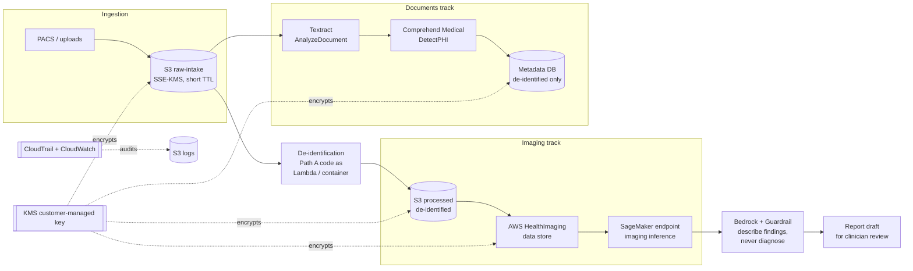

# Path B: AWS-Managed Healthcare

The **AWS-managed** way to build the imaging pipeline. Path A (the Python code in
this repo) does everything in our own code. Path B uses AWS managed services:
Amazon S3, AWS KMS, AWS HealthImaging, Amazon Textract, Amazon Comprehend
Medical, Amazon SageMaker and Amazon Bedrock.

> **Status:** setup guide. **Next:** infrastructure as code (IaC) for every step
> marked **IaC** in the tables below. Steps marked **Manual** stay documented here.

> [!IMPORTANT]
> **Data residency comes first.** UAE health data must be stored and processed inside
> the UAE unless an exception applies (Federal Law No. 2 of 2019; see the main
> [README](../README.md#uae-compliance-notes)). Several services below may **not** be
> offered in the UAE region (`me-central-1`). Check the
> [AWS Regional Services List](https://aws.amazon.com/about-aws/global-infrastructure/regional-product-services/)
> for **each** service before you design. Until residency is cleared with your
> regulator and counsel, use this path only with **synthetic or public** data
> (see [Getting DICOM test data](../README.md#getting-dicom-test-data-public-sources)).

---

## Contents

- [Architecture](#architecture)
- [Step 0: Before you start](#step-0-before-you-start)
- [Step 1: Environment setup](#step-1-environment-setup-foundational-before-any-ai-service)
- [Step 2: Amazon Bedrock setup](#step-2-amazon-bedrock-setup)
- [Step 3: Amazon SageMaker setup](#step-3-amazon-sagemaker-setup)
- [Step 4: Imaging track (HealthImaging) and Documents track (Textract)](#step-4-imaging-track-and-documents-track)
- [How Path A fits into Path B](#how-path-a-fits-into-path-b)
- [Infrastructure-as-code plan](#infrastructure-as-code-plan)
- [Cost drivers](#cost-drivers)
- [Checklist](#checklist)

---

## Architecture



All traffic between services goes through **VPC endpoints (PrivateLink)**, never
the public internet. Every data store is encrypted with the **customer-managed KMS key**.

---

## Step 0: Before you start

| # | Task | How |
|---|---|---|
| 0.1 | Check regional availability of **every** service above in your target region, and decide the region | Manual |
| 0.2 | Use separate AWS accounts for dev and prod (AWS Organizations) | Manual (once) |
| 0.3 | 🔶 Add a Service Control Policy that **denies all regions except your approved one(s)**. This technically enforces residency and cannot be bypassed by a mis-set SDK region. | IaC |
| 0.4 | Confirm governance: DPIA, data sharing agreement, legal sign-off on any cross-border processing | Manual |

---

## Step 1: Environment setup (foundational, before any AI service)

| # | Task | Details | How |
|---|---|---|---|
| 1.1 | **Create S3 buckets**: `raw-intake`, `processed`, `logs` | Versioning **on**, default encryption **SSE-KMS** (the key from 1.2) on all three. 🔶 Also: Block Public Access on, a bucket policy that denies non-TLS requests, and names prefixed with project and account (bucket names are global). | IaC |
| 1.2 | **Create a customer-managed KMS key** for encryption at rest | Automatic key rotation on. Key policy grants use only to the service roles in 1.3. Optionally one key per data class (raw vs processed). | IaC |
| 1.3 | **Create IAM roles, one per service, least privilege only** | HealthImaging import role, SageMaker execution role, Bedrock invoke role, Textract/Comprehend Medical role. **Never one shared admin role.** Each role gets only its own bucket prefixes, its own KMS key and its own resource ARNs. | IaC |
| 1.4 | **Create VPC endpoints (PrivateLink)** | S3 (gateway endpoint), SageMaker API + Runtime, Bedrock Runtime, HealthImaging, Textract, Comprehend Medical, KMS, CloudWatch Logs. Keeps traffic off the public internet: **this is the PDPL/residency talking point.** 🔶 Check endpoint availability per service and region. | IaC |
| 1.5 | **Enable CloudTrail** (management **and** data events) **and CloudWatch Logs from day one** | Data events for the S3 buckets and HealthImaging. Log-file validation on, logs to the `logs` bucket encrypted with KMS. *You cannot retroactively audit what you did not log.* | IaC |
| 1.6 | **Apply a consistent tagging scheme** | `project`, `environment`, `data-classification` (e.g. `phi-raw`, `deidentified`, `public`), `owner`. Used for cost tracking and in IAM conditions (e.g. deny reading `phi-raw` outside the pipeline roles). | IaC (+ tag policy) |
| 1.7 | 🔶 **Lifecycle rules** | `raw-intake`: expire objects after a short TTL once processed (e.g. 24 h). `logs`: long retention to match health-record rules; consider S3 Object Lock. | IaC |

---

## Step 2: Amazon Bedrock setup

| # | Task | Details | How |
|---|---|---|---|
| 2.1 | **Request model access** | Bedrock console → *Model access* → request the foundation model you will use (any text model available in your region). Approval is usually instant. | **Manual** (console, once per account/region) |
| 2.2 | **Create a Guardrail** | **Denied topics:** diagnosis, treatment or medication advice. **Sensitive-information filters:** names, addresses, phone numbers, emails, IDs. Add custom regexes for MRNs and the UAE national ID format (`784-\d{4}-\d{7}-\d`). **Content filters:** default harmful-content categories. | IaC |
| 2.3 | **Write and save the system prompt** | The "describe findings, never diagnose" instruction (example below). 🔶 Version it in this repo or in SSM Parameter Store, not only in the console. | Manual (write) + IaC (store) |
| 2.4 | **Scope the IAM policy** | `bedrock:InvokeModel` (and `bedrock:ApplyGuardrail`) on the **specific model ARN and guardrail ARN only**, never `*`. | IaC |
| 2.5 | **Test in the Bedrock playground** | Use a sample (synthetic) finding before wiring anything into code. Confirm that the guardrail blocks a request for a diagnosis. | **Manual** |
| 2.6 | **Wire the guardrail ID into the API call** | Every model call passes the guardrail identifier and version (snippet below). | Code |

Example system prompt (2.3):

```text
You are a radiology reporting assistant. You receive structured, de-identified
imaging findings. Describe the findings in clear clinical language for a
radiologist to review. Never state a diagnosis, never recommend treatment, and
never guess at patient identity. If the input asks for a diagnosis, reply that a
qualified clinician must make it. Every output is a draft for human review.
```

Calling the model with the guardrail (2.6):

```python
import boto3

bedrock = boto3.client("bedrock-runtime", region_name=REGION)
response = bedrock.converse(
    modelId=MODEL_ID,                         # the specific model allowed by the IAM policy
    system=[{"text": SYSTEM_PROMPT}],
    messages=[{"role": "user", "content": [{"text": findings_json}]}],
    guardrailConfig={"guardrailIdentifier": GUARDRAIL_ID, "guardrailVersion": GUARDRAIL_VERSION},
)
draft = response["output"]["message"]["content"][0]["text"]
```

---

## Step 3: Amazon SageMaker setup

| # | Task | Details | How |
|---|---|---|---|
| 3.1 | **Create a SageMaker Domain (Studio) or a notebook instance** | In the private VPC from step 1, with no direct internet access | IaC |
| 3.2 | **Attach the SageMaker execution role** | S3 read/write **scoped to your buckets and prefixes only**, plus use of the KMS key | IaC |
| 3.3 | **Deploy the pretrained model artifact to a real-time endpoint** | Model (`model.tar.gz` in S3 + container image) → endpoint config → endpoint. Pick the instance type for the workload, e.g. `ml.g4dn.xlarge` (GPU) for imaging inference. | IaC (the artifact itself is Manual / ML pipeline) |
| 3.4 | **Configure endpoint auto-scaling** | Min/max instance count; target-tracking on invocations per instance | IaC |
| 3.5 | **Test the endpoint directly** | `invoke_endpoint()` with a sample payload **before** connecting it to the pipeline (snippet below) | **Manual** (then an automated smoke test) |
| 3.6 | **Turn on Model Monitor and endpoint CloudWatch logging** | 🔶 Data capture stores request payloads, so it must be KMS-encrypted and fed **only de-identified** input | IaC |

```python
import boto3, json

runtime = boto3.client("sagemaker-runtime", region_name=REGION)
response = runtime.invoke_endpoint(
    EndpointName=ENDPOINT_NAME,
    ContentType="application/json",
    Body=json.dumps(sample_payload),
)
print(json.loads(response["Body"].read()))
```

---

## Step 4: Imaging track and Documents track

### Imaging track: AWS HealthImaging

| # | Task | Details | How |
|---|---|---|---|
| 4.1 | **Create a Data Store** in AWS HealthImaging | Encrypted with the customer-managed KMS key | IaC |
| 4.2 | **Start an Import Job** | Point it at the S3 location of your DICOM files. 🔶 **Import from `processed` (de-identified), not `raw-intake`.** HealthImaging stores what it receives and does **not** de-identify. Import identifiable data only in a separately approved clinical workflow. The job also needs an output S3 location for its result manifest, and the import role from 1.3. | Code / scheduled job (runtime operation, not infrastructure) |
| 4.3 | **Query image sets via the API** | Metadata search, metadata retrieval, frame retrieval (snippet below) | Code |
| 4.4 | **Scope IAM permissions** | To **that specific Data Store ARN** only | IaC |

```python
import boto3

hi = boto3.client("medical-imaging", region_name=REGION)

job = hi.start_dicom_import_job(
    datastoreId=DATASTORE_ID,
    dataAccessRoleArn=IMPORT_ROLE_ARN,
    inputS3Uri="s3://<processed-bucket>/dicom/batch-001/",
    outputS3Uri="s3://<logs-bucket>/healthimaging-import/batch-001/",
    jobName="batch-001",
)

found = hi.search_image_sets(
    datastoreId=DATASTORE_ID,
    searchCriteria={"filters": [{"values": [{"DICOMPatientId": "PT-0E2B4AAA9B52D73C"}], "operator": "EQUAL"}]},
)
```

Searching by `PT-…` works because Path A replaced the patient ID with its token
before import.

### Documents track: S3 + Textract + Comprehend Medical

| # | Task | Details | How |
|---|---|---|---|
| 4.5 | **Upload scanned documents** (referrals, forms, reports) to `raw-intake` | Under a `documents/` prefix; short TTL (1.7) | Code / upload process |
| 4.6 | **Call Textract `AnalyzeDocument`** (FORMS + TABLES) for OCR and structure | 🔶 `AnalyzeDocument` is synchronous and single-page. Multi-page PDFs use `StartDocumentAnalysis` (asynchronous). | Code |
| 4.7 | **Pass the extracted text through Comprehend Medical** `DetectPHI` | Redact every detected entity. 🔶 Long documents must be split into chunks within the API's size limit. | Code (Path A: `scripts/deidentify_with_comprehend_medical.py`) |
| 4.8 | **Store structured, de-identified output in the metadata database, not raw text** | Same schema principles as Path A's database (tokens, no direct identifiers) | Code + IaC (database) |

```python
import boto3

textract = boto3.client("textract", region_name=REGION)
cm = boto3.client("comprehendmedical", region_name=REGION)

doc = textract.analyze_document(
    Document={"S3Object": {"Bucket": RAW_BUCKET, "Name": "documents/referral_001.png"}},
    FeatureTypes=["FORMS", "TABLES"],
)
text = "\n".join(b["Text"] for b in doc["Blocks"] if b["BlockType"] == "LINE")
phi = cm.detect_phi(Text=text)["Entities"]   # then redact, keep only structured fields
```

Try this offline first: Demo 2 in the main README runs the same flow on
synthetic referral letters with no AWS account.

---

## How Path A fits into Path B

| Pipeline stage | Path A (this repo) | Path B (AWS-managed) |
|---|---|---|
| Landing zone | local folder | S3 `raw-intake` |
| Read / inspect DICOM | `dicom_deid.loader`, `dicom-deid inspect` | HealthImaging metadata APIs (after import) |
| **De-identify DICOM** | `dicom_deid` pipeline | **Path A code, run as Lambda / container.** HealthImaging does not de-identify. |
| Verify, then quarantine burned-in text | `verify.py` + quarantine | Same code; Phase 1 adds Textract/Rekognition OCR on quarantined frames |
| Store and index images | local files + SQLite/PostgreSQL | S3 `processed` + HealthImaging data store |
| Free-text PHI | regex (`text_deid.py`) | Textract + Comprehend Medical |
| Inference | not in scope | SageMaker endpoint |
| Report drafting | not in scope | Bedrock + Guardrail |
| Audit | `deid_audit_events` table | CloudTrail + CloudWatch, plus the same audit table |

---

## Infrastructure-as-code plan

**Recommended tool: AWS CDK in Python.** It uses the same language as Path A, and it
compiles to CloudFormation, which supports the HealthImaging data store and the
Bedrock guardrail as resources. Terraform is the alternative if your team
already standardises on it. We confirm the tool before writing the code.

| Resource | Step | IaC? | CloudFormation resource |
|---|---|---|---|
| Region-restriction SCP | 0.3 | ✅ | `AWS::Organizations::Policy` |
| S3 buckets + policies + lifecycle | 1.1, 1.7 | ✅ | `AWS::S3::Bucket`, `AWS::S3::BucketPolicy` |
| KMS key | 1.2 | ✅ | `AWS::KMS::Key` |
| IAM roles and policies | 1.3, 2.4, 3.2, 4.4 | ✅ | `AWS::IAM::Role` |
| VPC + endpoints | 1.4 | ✅ | `AWS::EC2::VPC`, `AWS::EC2::VPCEndpoint` |
| CloudTrail + log groups | 1.5 | ✅ | `AWS::CloudTrail::Trail`, `AWS::Logs::LogGroup` |
| Tags / tag policy | 1.6 | ✅ | stack-level tags, `AWS::Organizations::Policy` |
| Bedrock guardrail | 2.2 | ✅ | `AWS::Bedrock::Guardrail` |
| System prompt (stored) | 2.3 | ✅ | `AWS::SSM::Parameter` |
| SageMaker domain | 3.1 | ✅ | `AWS::SageMaker::Domain` |
| SageMaker model / endpoint | 3.3 | ✅ | `AWS::SageMaker::Model`, `EndpointConfig`, `Endpoint` |
| Endpoint auto-scaling | 3.4 | ✅ | `AWS::ApplicationAutoScaling::ScalableTarget`, `ScalingPolicy` |
| Model Monitor / data capture | 3.6 | ✅ | endpoint config `DataCaptureConfig`, `AWS::SageMaker::MonitoringSchedule` |
| HealthImaging data store | 4.1 | ✅ | `AWS::HealthImaging::Datastore` |
| Metadata database | 4.8 | ✅ | `AWS::RDS::DBInstance` (PostgreSQL) |
| De-identification function | – | ✅ | `AWS::Lambda::Function` or ECS task (Path A code) |

**Stays manual (documented here, not coded):**

| Step | Why |
|---|---|
| 0.1, 0.2, 0.4: region choice, accounts, governance | Decisions and legal sign-off, not resources |
| 2.1: Bedrock model access | Console request per account/region |
| 2.3: writing the system prompt | Human-authored; only its storage is IaC |
| 2.5: playground testing | Human evaluation of model and guardrail behaviour |
| 3.3: the model artifact itself | Produced by an ML training pipeline, not infrastructure |
| 3.5: first endpoint test | Manual first; then an automated smoke test |
| 4.2: import jobs, 4.3: queries, 4.5–4.7: document processing | Runtime operations that run in code or on a schedule, not infrastructure |

---

## Cost drivers

- **SageMaker GPU endpoints** bill for every hour they run, even when idle. Set auto-scaling minimums carefully and delete dev endpoints after use.
- **Interface VPC endpoints** bill per endpoint, per availability zone, per hour.
- **CloudTrail data events** bill per event. Scope them to the buckets and data stores that matter.
- **HealthImaging**, **Textract** and **Comprehend Medical** bill for storage and per request or per page. Estimate with synthetic batches first.
- Use the `project` / `environment` tags (1.6) for cost allocation from day one.

---

## Checklist

- [ ] Region and residency confirmed for every service (0.1, 0.4)
- [ ] Region-restriction SCP active (0.3)
- [ ] 3 buckets, KMS key, per-service roles, VPC endpoints, CloudTrail, tags (1.x)
- [ ] Bedrock model access, guardrail, versioned system prompt, scoped IAM, playground test (2.x)
- [ ] SageMaker domain, endpoint, auto-scaling, smoke test, monitoring (3.x)
- [ ] HealthImaging data store; import from **de-identified** `processed` only (4.1–4.4)
- [ ] Textract → Comprehend Medical → de-identified metadata DB (4.5–4.8)
- [ ] Path A de-identification deployed in front of every import
